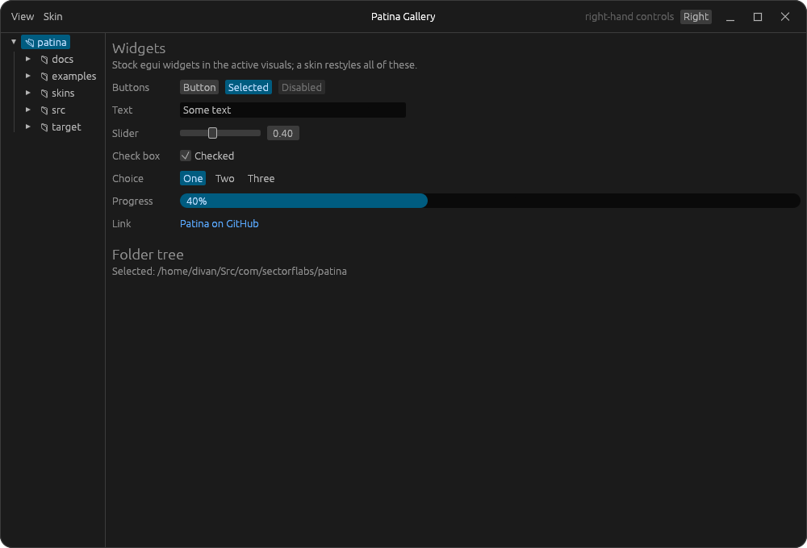

# Patina

Patina is the shared window frame, components and design language of a family of
[egui](https://github.com/emilk/egui) desktop apps. [Photograph](https://github.com/divanvisagie/Photograph)
and [UnAmp](https://github.com/divanvisagie/UnAmp) are the first.

You can skin each app completely differently. What they share is how they behave: one window
frame, one skin format and one set of rules. It's unity in variety, the way a terrace of
identical houses painted in different colours is beautiful: the structure stays, the skin varies. See [docs/design.md](docs/design.md).



## Use

```toml
[dependencies]
patina-ui = "0.1"
```

```rust
use patina::frame::{self, FrameStyle, TitleBar};

let style = FrameStyle::from_visuals(ui.visuals());
let radius = frame::corner_radius(ui.ctx(), style.radius);
egui::Panel::top("header")
    .frame(frame::header_frame(ui.style(), &style, radius))
    .show(ui, |ui| {
        TitleBar::new("My App", &style).show(ui, |ui| { /* left */ }, |ui| { /* right */ });
    });
```

The full wiring is in [`src/frame.rs`](src/frame.rs) and [`examples/gallery.rs`](examples/gallery.rs).
It covers the viewport, clear colour, edges and input hook.

Patina re-exports `egui`, and an app has to use the same egui version.

## Components

- **`frame`**: the app's own window frame, with a header bar, minimise/maximise/close buttons, resize
  edges and rounded corners. Moving and resizing go to the compositor.
- **`appearance`**: follows the desktop's light/dark setting through the XDG portal.
- **`skin`**: skins in the suite format, which every app reads, with app sections, a skins
  folder per app (`skin::app_dir`) and the built-ins Dark Orange, Calendar, Notebook and Steam Classic. See [docs/skinning.md](docs/skinning.md).
- **`tabs`**: tabs in the title bar after the menus, in place of the window title: each square and the
  bar's full height, the shown one joined to the panel below, with a close cross on hover and `+` (each optional: `closable`, `new_tab`), and
  Ctrl+T, Ctrl+W (Ctrl+Shift+T and W in a terminal, `terminal_keys`), Ctrl+PageUp/PageDown and Alt+1 to Alt+9. The app owns the tabs and applies the
  `TabAction`s. Tabs can be dragged into another order (`movable`), and some can be launchers,
  faded icons for something not open (`launchers`).
- **`tree`**: a sidebar folder tree that lists folders on worker threads, so slow network shares
  never block the UI.
- **`ime`**: `drop_repeated_preedits`, for `App::raw_input_hook`. Without it, a focused text field
  on GNOME's Wayland keeps the window repainting at full speed.
- **`markdown`** (cargo feature `markdown`): markdown shown as Notebook shows it, with no syntax
  on screen: an `Editor` that edits in place or, read-only, only shows, selects and hands clicked
  links to the app; tables, highlighted code and images; and `embeds::code_file` for a whole
  source file. Call `markdown::install` once for its fonts and image loaders. See
  [ADR-0015](docs/adr/0015-markdown-from-notebook.md).
- **`open`**: `open::path` opens a file or folder in the desktop's app for it (`xdg-open` on
  Linux), so "Open skins folder" lands in the file manager. egui's `open_url` would send a
  `file://` URL to the web browser.

Known problems and what's understood about them are in [docs/known-issues.md](docs/known-issues.md).
Traps any egui app can fall into, such as burning a core while idle, are in
[docs/egui-pitfalls.md](docs/egui-pitfalls.md).

## Develop

```sh
make              # list targets
make gallery      # every component on one screen
make test         # tests
make check        # tests and clippy
make screenshot   # docs/gallery-*.png
```

What changed in each version, and what an app has to change to take it, is in
[CHANGELOG.md](CHANGELOG.md). Add to its Unreleased section in the same commit as the change.

Decisions are recorded as ADRs in [docs/adr](docs/adr/README.md), and we recommend the same for
every Patina app.

## License

BSD-3-Clause
