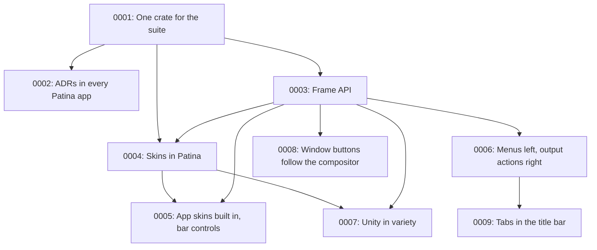

# Architecture Decision Records

This directory holds ADRs for Patina — short records of significant architecture decisions,
written at the time they're made, following Michael Nygard's format as popularized by Martin
Fowler: <https://martinfowler.com/bliki/ArchitectureDecisionRecord.html>.

## When to write one

Write an ADR when a decision is:

- Hard, or expensive, to reverse once other code depends on it.
- Not obvious from reading the code — a "why", not a "what".
- The kind of thing that'll get re-litigated later without a record ("didn't we already decide
  this?").

Small, reversible choices don't need one. Rule of thumb: if you'd want to explain the choice to a
new contributor in a paragraph beyond what the code itself shows, it's ADR-sized.

An ADR is a point-in-time record of *a decision as it was made*, including the options considered
and rejected. It does not get rewritten later — a decision that reverses or replaces an earlier one
gets its own new ADR that supersedes the old one, which stays in place with its status updated.

## Convention

- One file per decision: `NNNN-short-kebab-title.md`, numbered sequentially, zero-padded to 4
  digits. Numbers are never reused, even for a decision that gets reversed.
- Start from [`0000-template.md`](0000-template.md) — copy it, don't write from scratch.
- `Status` is one of: `Proposed`, `Accepted`, `Rejected`, `Deprecated`, or `Superseded by
  ADR-NNNN` (linked to the superseding record).
- Every new ADR gets a row in the index below.
- Keep records short — a paragraph or two per section is normal. An ADR documents a decision and
  its reasoning, not a design document.

For the design language itself, see [../design.md](../design.md).

If you are working with Claude Code in this repo, `.claude/skills/adr/SKILL.md` handles the
mechanics of adding one. Patina apps should keep ADRs the same way
([ADR-0002](0002-adrs-in-every-patina-app.md)): copy this README (minus the index),
`0000-template.md` and the skill.

## Index

| # | Title | Status |
|---|-------|--------|
| [0001](0001-one-crate-for-the-suite.md) | Share the suite's frame and components as one published crate, Patina | Accepted |
| [0002](0002-adrs-in-every-patina-app.md) | Recommend ADRs for every Patina app, and keep them for Patina itself | Accepted |
| [0003](0003-frame-api.md) | The frame's API: a TitleBar builder with left and right slots, styled by FrameStyle | Proposed |
| [0004](0004-skins-in-patina.md) | Move the suite skin format into Patina, with a shared skins folder and Dark Orange built in | Proposed |
| [0005](0005-app-skins-built-into-patina.md) | Build Calendar, Notebook and Steam Classic into Patina, and colour controls on a coloured bar | Accepted |
| [0006](0006-title-bar-menus-left-output-actions-right.md) | Title bar: word menus on the left, the app's output actions on the right | Accepted |
| [0007](0007-unity-in-variety.md) | Unity in variety: the structure is shared, the skin varies, and GNOME is only a source of defaults | Accepted |
| [0008](0008-window-buttons-follow-the-compositor.md) | Show only the window buttons the compositor supports, found by compositor name for now | Accepted |
| [0009](0009-tabs-in-the-title-bar.md) | Tabs in the title bar, as a component apps fill with their own tabs | Proposed |

## Decision Relationship

## Revisit Triggers

- An app needs a frame option the builder lacks, or a desktop where the frame misbehaves. See
  [ADR-0003](0003-frame-api.md).
- egui releases break the apps' shared upgrade, or one app needs to stay behind. See
  [ADR-0001](0001-one-crate-for-the-suite.md).
- A shared skin key needs to differ between apps, or users want per-app overrides of a shared
  skin. See [ADR-0004](0004-skins-in-patina.md).
- winit exposes Wayland's `wm_capabilities`, or a compositor in the window-button table changes
  what it supports. See [ADR-0008](0008-window-buttons-follow-the-compositor.md).
- A component only one app uses keeps growing app-specific options. Move it back into the app.
