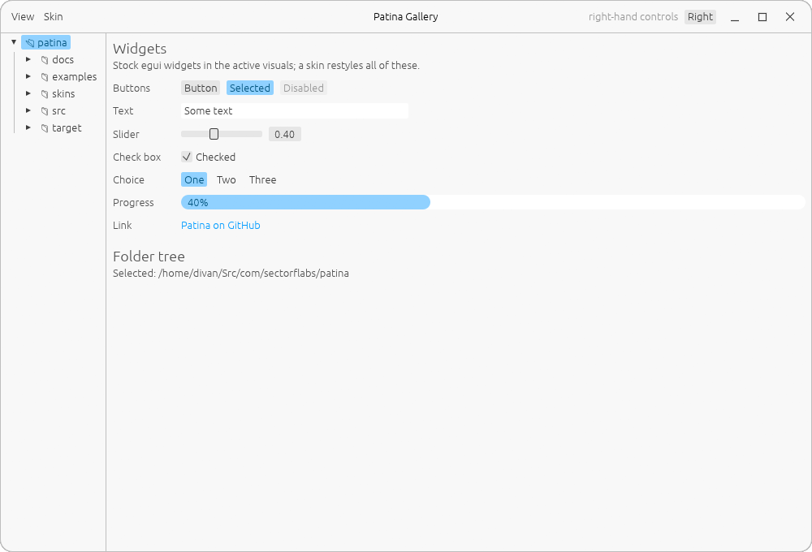

# The Patina design language

Patina is how a family of egui desktop apps looks and behaves. Photograph and UnAmp are the first.
The idea comes from an older way of thinking about desktop apps: each app can be skinned until it
looks nothing like its siblings, yet they all keep the same rules. Patina is those rules, plus the
shared code that makes them easy to follow.

KDE and GNOME make their apps look alike. Patina only makes them behave alike, and leaves the
look to each app and its skins. It doesn't follow GNOME or any other desktop's look: a few
defaults (the 15 px window radius, the close button's red) were borrowed from GNOME as starting
points, and that's all.

## Principles

1. **Stock egui first.** With no skin chosen, an app uses egui's default `Style`, `Visuals` and
   fonts, following the desktop's light/dark setting. Only paint your own widget when egui has
   none, and then take its colours from the active `Visuals`.
2. **Skinnable all the way down.** Every colour an app paints must be reachable from its skin,
   including the window frame. A skin a user writes must never crash the app. Bad values are
   reported, and unknown keys are ignored with a warning.
3. **Unity in variety.** Beautiful towns hold some things constant and let others vary. A
   terrace of identical houses painted in different colours is lovely, and so is a street of
   differently shaped buildings in one stone. When everything is the same the street is dull,
   and when everything differs at once it's noise. The School of Life's
   [How to Make an Attractive City](https://www.youtube.com/watch?v=Hy4QjmKzF1c) makes the case
   for order and variety in balance. Thomas Sharp made the same point earlier as "unity in variety"
   ([*Town and Townscape*](https://researcharchive.ncl.ac.uk/sharp/galrev/tandt.html), 1968).
   Patina works the same way ([ADR-0007](adr/0007-unity-in-variety.md)):
   - **Constant:** the structure. That means the frame's layout, where things go, how they
     behave, and the skin format's shared sections.
   - **Varied:** the skin, meaning colour, rounding, shadows and each app's own section.
   - A skin may restyle anything, but never moves things or changes how they behave.
   - An app adds its own parts under its own skin section and code. It keeps the shared frame
     and menus where every Patina app has them.
   - Within one skin, don't vary everything at once. A skin that changes shapes, such as Steam
     Classic's square corners, holds to a narrow palette. A skin with a bold palette keeps the
     shapes calm.
4. **Feel native to the desktop.** Moving, resizing, snapping and tiling are left to the
   compositor, and the light/dark setting follows the XDG portal. Native means behaving well on
   the desktop, not copying its look. A system title bar is always available as a setting, in
   case the app's own frame misbehaves on someone's desktop.
5. **Never block the UI.** File and network I/O happen off the UI thread. A hung network share
   can slow a view down but must never freeze the window (see `tree`).
6. **Record decisions.** Every Patina app keeps ADRs ([ADR-0002](adr/0002-adrs-in-every-patina-app.md)).

## The window

Implemented by `patina::frame`.

- **The app draws its own frame.** The window opens undecorated and transparent, and the top
  panel is a header bar.
- **Header bar layout:** a menu bar on the left, the title in the centre, and the app's output
  actions on the right, next to the window buttons
  ([ADR-0006](adr/0006-title-bar-menus-left-output-actions-right.md)).
  - **Left: a standard menu bar,** in words: File, Edit, View, then the app's own menus, then
    Skins. Not a hamburger menu. Actions that make a new item (New Note, New Folder) go in
    the app's sidebar or tree as well as in File.
  - **Right: the actions that serve the app's goal,** its main output. Examples:
    - Photograph: Render, and Edit for the selected photo.
    - Notebook: the Markdown source switch and the formatting buttons.
    - Calendar: Today and the Day/Week/Month switch.

    A consumption app with no output, like UnAmp, a music player, leaves the right side empty.
  - **Elsewhere:** settings, status and secondary information go in the menus, a sidebar or the
    status bar, not the title bar. Photograph's GPU status sits in its status bar.
- **Status bar:** every app has one along the bottom, holding both bottom corners
  ([ADR-0016](adr/0016-a-status-bar-for-messages.md)).
  - **Left:** the version (`v0.1.0`, no app name: the title bar has it), small and weak.
  - **Next to it:** the latest message, red for errors, yellow for warnings, the weak text colour
    otherwise. Menus never report; what an action did goes here.
  - **Right:** the app's own standing information, such as Photograph's GPU, or nothing.
  - The title is centred on the window, not on the gap between the controls, and gets an
    ellipsis when there's no room.
  - When a skin colours the bar, the bar's own menus and buttons are drawn in its title colour.
    Their menus open in the skin's normal colours.
  - The bar's padding is 12 px horizontal and 8 px vertical. The row is 25 px high.
- **Window buttons:** minimise, maximise/restore and close, 30×22 px, 4 px apart, kept 8 px from
  the right-hand controls.
  - They're quiet until hovered. Close turns red (`#c01c28`, GNOME's, as a default) with a white
    icon on hover.
  - Their colours are skinned apart from the app's buttons.
  - Where the compositor can't minimise or maximise (dwl), only close is shown, and the window
    menu and double-click leave those out too. `frame::can_minimise_and_maximise` decides, for now
    from a table of compositors by process name, because winit 0.30 drops Wayland's
    `wm_capabilities` (ADR-0008).
- **On the bar's empty space:** drag to move, double-click to maximise or restore, right-click
  for a window menu.
- **Edges:** a one-pixel border in the window stroke colour, and invisible resize handles 5 px
  deep (12 px at the corners), drawn above everything else.
- **Corners:** a 15 px window radius by default (borrowed from GNOME; skins change it), square
  while maximised or full screen.
  - The clear colour is transparent, so the panel holding each corner carries the rounding.
  - The header bar holds both top corners. The bottom corners belong to whichever panels sit
    there, e.g. a sidebar on the left and the central panel on the right, or a status bar
    across the bottom holding both.

## Sizes and menus

- **Nothing clickable is smaller than 24×24 px**
  ([ADR-0022](adr/0022-clickable-elements-are-at-least-24-px.md)): buttons, menu items, checkboxes,
  icons that act. Text that's only read can be any size. Where egui's default is smaller (its
  buttons are 18 px high), give the widget more room rather than shrink the target.
- **Menus are egui's, 24 px an item:** `patina::menu::style`, egui's menu style with
  `menu::ITEM` high items. Open a context menu with `patina::menu::context(&response, ...)`, not
  `response.context_menu`, which keeps egui's 18 px.

## Skins

Implemented by `patina::skin`. The format is documented in [skinning.md](skinning.md).

- **Same files in every app:** skins use the suite format, with a `format` version, shared
  `[colors]`, `[controls]` and `[window]` sections, and one `[app.<name>]` section per app.
  - Keys are named for a role (`surface`, `pressed`, `title_bar`), not for a widget or an app
    feature.
- **Where they come from:**
  - **Default:** stock egui, following the desktop.
  - **Patina's built-ins:** Dark Orange (Photograph's look), Calendar, Notebook and Steam Classic.
  - **The app's own built-ins.**
  - **The user's skins:** in the app's own `~/.config/<app>/skins/`. Each app keeps its own
    ([ADR-0011](adr/0011-each-app-its-own-skins-folder.md)).
- **A home skin, if it suits the app:** an app may start in a skin that fits it, before the user
  picks one. Photograph starts in Dark Orange, Calendar in Calendar and Notebook in Notebook.
  This is optional and not one of the rules: UnAmp has none and starts in Default. Whatever the
  app starts in, it offers every skin.
- **The skin menu** is the same in every app
  ([ADR-0017](adr/0017-the-skin-menu-holds-only-controls.md)): the skins (yours as `Name — Author`,
  path on hover); Follow desktop, Light, Dark; then Reload skins, Copy built-in skins to folder and
  Open skins folder. Sentence case, as wide as its widest entry, and no messages in it.
- **Within the rules:** a skin copied into any app's folder brings its shared look with it. The app's
  own section waits until that app reads the file. This is how an app can look completely
  different from its siblings while sharing everything else: unity in the structure, variety in
  the skin (principle 3).

## Components

| Module | What | From |
|--------|------|------|
| `frame` | Own window frame: header bar, window buttons, edges, compositor hand-off | UnAmp, Photograph |
| `appearance` | Follow the desktop's light/dark setting (XDG portal) | UnAmp, Photograph |
| `skin` | Suite skin format: parse, apply to egui, frame colours, app sections, loading | UnAmp |
| `tree` | Lazily loaded sidebar folder tree | UnAmp |
| `menu` | Menus' style, 24 px items, and context menus in it | Files, the Patina desktop |

Run `make gallery` to see each one. A component belongs in Patina when a second app wants it.
It may use only std, egui and small helper crates, never an app's own types
([ADR-0001](adr/0001-one-crate-for-the-suite.md)).
