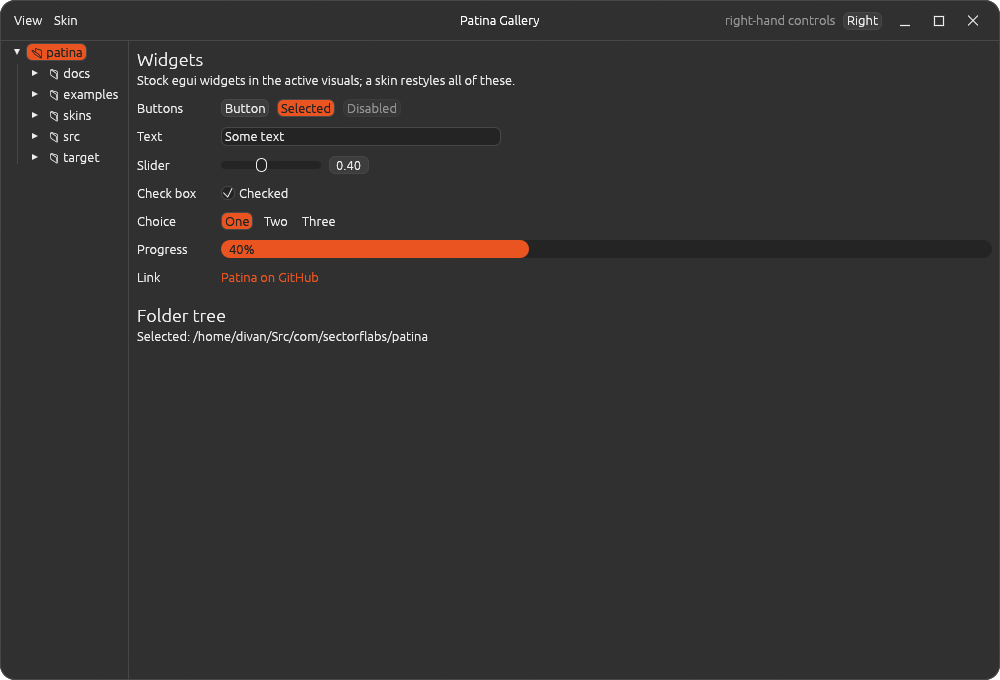

# Patina skins

Every Patina app can be skinned with the same TOML files, in the **suite skin format**, version 1.
The format began as UnAmp's skins (UnAmp ADR-0024) and moved here in
[ADR-0004](adr/0004-skins-in-patina.md).

- **Shared sections:** `[colors]`, `[controls]` and `[window]` mean the same in every app, and
  Patina applies them.
- **App sections:** each app's own parts go under `[app.<name>]`, e.g. `[app.unamp]`. An app reads
  only its own section and skips the others.
- **Forward-compatible:** a file written for a newer version of the format still loads, with a
  warning.



## Which skins an app offers

| Skin | Where | What |
|---|---|---|
| **Default** | Built in, no file | Stock egui, following the desktop's light/dark setting |
| **Dark Orange** | Patina's [`skins/dark-orange.toml`](../skins/dark-orange.toml), in every app | Yaru-style dark greys and Ubuntu orange, the look Photograph was built in |
| An app's built-ins | Compiled into that app | e.g. UnAmp's Steam Classic |
| Yours | `~/.config/patina/skins/*.toml`, read by every Patina app, plus any folder of the app's own | Anything |

A skin with the same `name` as one listed before it **replaces** it. That's how you customise a
built-in: copy it into your folder (apps offer "Copy built-in skins to folder", which never
overwrites) and edit your copy. Delete the copy to go back to the built-in.

Problems are shown in the app's skin menu:

- A bad value, such as `text = "green"`, is an error, and that skin is skipped.
- An unknown key is listed, but the skin still loads. A misspelt `bakground` gets caught this way
  without breaking anything.

## Writing a skin

Every key except `format` and `name` is optional. **Any colour you leave out keeps egui's
default** for the `base` skin, so a skin can be as small as this:

```toml
format = 1
name = "Just Purple"
base = "dark"

[colors]
accent = "#8A2BE2"
```

Colours are `"#RRGGBB"` or `"#RRGGBBAA"`. Use [Dark Orange](../skins/dark-orange.toml) as a full
example.

### Top-level keys

| Key | Type | Meaning |
|---|---|---|
| `format` | integer, **required** | Skin format version: `1`. A file without it is UnAmp's old skin format and is rejected. |
| `name` | string, **required** | Name in the app's skin menu. Matching a built-in's name replaces it. |
| `author` | string | Shown in the skin menu. |
| `base` | `"dark"` or `"light"` | The egui theme (light or dark) the skin starts from. A skin fixes it; only Default follows the desktop. |
| `corner_radius` | integer (px) | Rounding of panels, menus and controls. `0` is square. Also the main window's corners, unless `[window] corner_radius` is set. |
| `shadows` | bool | `false` removes window and popup shadows. |

### `[colors]`: the base palette

| Key | Used for |
|---|---|
| `background` | Panels, and the windows inside the app |
| `surface` | Inset areas: text fields, lists, slider tracks |
| `surface_alt` | Alternate rows in lists |
| `border` | Outlines of windows and panels (and of controls, unless `[controls] border` is set) |
| `text` | Normal text |
| `text_strong` | Headings (and text on hovered controls, unless `[controls] text_hover` is set) |
| `text_weak` | Secondary labels (section headings, counts, status) |
| `accent` | Selection, slider fill, toggles that are on |
| `accent_text` | Text drawn on top of `accent` (e.g. a selected item) |
| `link` | Links, and the current item in lists |
| `warning` | Warnings |
| `error` | Error messages |

### `[controls]`: buttons, sliders, checkboxes, drop-downs

| Key | Used for |
|---|---|
| `background` | A control at rest |
| `hover` | Under the mouse |
| `pressed` | While pressed |
| `text` | Text and icons on controls (defaults to `colors.text`) |
| `text_hover` | Text on hovered or pressed controls (defaults to `colors.text_strong`) |
| `border` | Control outlines (defaults to `colors.border`) |

egui draws buttons with one fill and slider/checkbox tracks with another. Tracks at rest use
`colors.surface`, so they stay visible when `controls.background` matches `colors.background`.

### `[window]`: the app's own frame

Every Patina app draws its own title bar and window edge (`patina::frame`).

| Key | Used for |
|---|---|
| `title_bar` | The title bar's background (defaults to `colors.background`) |
| `title_text` | The window title (defaults to `colors.text`) |
| `border` | The one-pixel window edge (defaults to `colors.border`) |
| `corner_radius` | The window's corners, in px. Defaults to the top-level `corner_radius`, else GNOME's 15. Square while maximised. |

### `[window.controls]`: minimise, maximise, close

These are skinned separately from `[controls]`, so the window buttons can look like a title bar's
and not like the app's buttons. Each falls back to the matching control colour.

| Key | Used for |
|---|---|
| `icon` | The symbols at rest |
| `icon_hover` | The symbols under the mouse |
| `hover` | Background under the mouse |
| `pressed` | Background while pressed |
| `close_hover` | Close's background under the mouse (default GNOME red) |
| `close_icon_hover` | Close's symbol under the mouse (default white) |

### `[app.<name>]`: an app's own parts

Each app documents its own section. For example, UnAmp's `[app.unamp]` colours its spectrum
analyzer and time display (see UnAmp's `docs/skinning.md`).

## For app authors

```rust
use patina::skin::{self, Skin};

// Default, Patina's built-ins, the app's own, then the user's folders.
let built_ins = [skin::BUILT_IN, MY_BUILT_INS].concat();
let dirs: Vec<_> = skin::shared_dir().into_iter().chain(my_app_dir()).collect();
let (skins, errors) = skin::load_all(&built_ins, &dirs);

let chosen: &Skin = &skins[i];
chosen.apply(ctx);                                     // egui's visuals
let frame = chosen.frame_style(ui.visuals());          // every frame; Default's follow the desktop
let (mine, warnings) = chosen.app_section::<MySkin>("myapp")?;  // your [app.myapp]
```

Name your section after your app, and use role names for its keys, the way the shared sections
do. The gallery's Skin menu (`examples/gallery.rs`) is a complete example.
